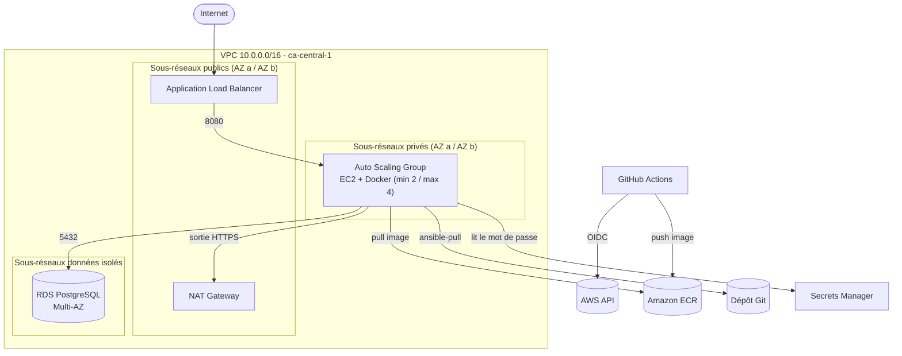
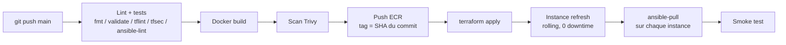

# Cloud-Native DevOps Showcase

Infrastructure AWS **hautement disponible, sécurisée et entièrement automatisée** : réseau multi-AZ, Auto Scaling, RDS Multi-AZ, déployée par **Terraform**, configurée par **Ansible**, livrée par un pipeline **GitHub Actions** sans aucune clé AWS statique.

    

## Architecture



## Flux de déploiement



## Choix d'architecture (et pourquoi)

| Décision | Justification |
| :--- | :--- |
| **Backend S3 + DynamoDB** | État partagé, chiffré, versionné, avec verrouillage : travail en équipe sûr. |
| **Bootstrap séparé** | Résout le problème de l'oeuf et de la poule (le backend ne peut pas se créer lui-même). |
| **3 niveaux de sous-réseaux** | Public (ALB/NAT), privé (app), isolé (BDD, aucune route Internet). |
| **Security Groups chaînés** | Internet → ALB → EC2 → RDS. Chaque couche n'accepte que la précédente. |
| **OIDC GitHub → AWS** | Aucune clé d'accès stockée : identifiants temporaires, rôle limité à ce dépôt. |
| **Mot de passe RDS géré par AWS** | Généré, stocké dans Secrets Manager et rotaté : il n'existe ni dans Git ni dans le pipeline. L'app le lit via son rôle IAM. |
| **IMDSv2 obligatoire** | Protège les credentials de l'instance contre les attaques SSRF. |
| **`ansible-pull` au boot** | Les instances sont privées et éphémères : toute instance recréée par l'ASG se configure seule, sans SSH ni intervention du pipeline. |
| **Tags d'image immuables (SHA)** | Chaque déploiement est traçable et reproductible ; pas de `latest`. |
| **Accès via SSM, pas de SSH** | Aucun port 22 ouvert, aucune clé à gérer. |
| **Health check `/health` indépendant de la BDD** | Une panne RDS ne vide pas le load balancer. |

## Structure du dépôt

```text
.github/workflows/    deploy.yml (CI/CD) · destroy.yml (nettoyage manuel)
terraform/
  bootstrap/          backend S3+DynamoDB, ECR, OIDC GitHub (exécuté une seule fois)
  modules/vpc/        VPC, sous-réseaux, IGW, NAT, flow logs
  modules/security/   Security Groups (moindre privilège)
  modules/compute_db/ ALB, ASG, launch template, IAM, RDS
  main.tf dns.tf ...  composition + HTTPS/Route 53 optionnel
ansible/
  playbook.yml        exécuté par ansible-pull sur chaque instance
  roles/              hardening · docker-setup · app-deploy
app/                  API Node.js (Express) + Dockerfile multi-étapes
docs/                 guide de déploiement · script de démo
```

## Démarrage rapide

Voir **[docs/DEPLOYMENT_GUIDE.md](docs/DEPLOYMENT_GUIDE.md)** pour la procédure complète pas à pas.

```bash
# 1. Bootstrap (une seule fois)
cd terraform/bootstrap
terraform init && terraform apply -var github_org=MON_COMPTE -var github_repo=MON_DEPOT

# 2. Renseigner les variables GitHub (AWS_ROLE_ARN, TF_STATE_BUCKET) puis :
git push origin main    # le pipeline fait le reste
```

## Critères de validation

- [x] **Zéro intervention manuelle** après le bootstrap : réseau → application, tout est piloté par Terraform et le pipeline.
- [x] **Haute disponibilité** : arrêt forcé d'une instance → l'ASG (health check ELB) la remplace, l'ALB continue de servir via l'autre AZ. *(procédure de test dans le guide)*
- [x] **Sécurité réseau** : instances et base sans IP publique, tout passe par l'ALB ; accès d'administration via SSM.
- [x] **DevSecOps** : tfsec, TFLint, ansible-lint, Trivy, IMDSv2, chiffrement EBS/RDS/S3, flow logs.

## Coût

Ordre de grandeur de **3 à 5 USD par jour** quand l'infrastructure tourne (NAT Gateway, ALB, RDS Multi-AZ, 2 instances), à vérifier avec l'AWS Pricing Calculator. **Détruisez après chaque démo** (workflow `Destroy infrastructure`).

## Retour d'expérience : difficultés rencontrées et résolutions

Ce projet a été construit et débogué sur un vrai compte AWS. Voici les problèmes rencontrés, leur cause racine et la solution retenue.

| # | Difficulté | Cause racine | Résolution |
| :-: | :--- | :--- | :--- |
| 1 | `make` introuvable sous Windows (PowerShell) | `make` n'est pas installé par défaut sous Windows | Exécution directe des commandes du `Makefile`, ou installation via `winget install GnuWin32.Make` |
| 2 | `docker build` échoue : `failed to connect to the docker API` | Docker Desktop installé mais moteur arrêté (le client `docker` n'est qu'une interface) | Démarrer Docker Desktop, attendre « Engine running », vérifier avec `docker info` |
| 3 | TFLint échoue (6 avertissements) | Les modules ne déclaraient ni `required_version` ni la version du provider AWS (règles « recommended ») | Ajout d'un `versions.tf` dans chaque module (`>= 1.5.0`, provider `~> 5.0`) |
| 4 | `Unable to resolve action aquasecurity/trivy-action@0.28.0` | Les anciens tags de l'action ont été retirés après une attaque sur la chaîne d'approvisionnement ; les tags sont désormais préfixés par `v` | Passage à un tag valide (`@v0.36.0`). **Leçon :** épingler les actions par SHA de commit, un tag étant modifiable |
| 5 | `Credentials could not be loaded` dans `configure-aws-credentials` | La variable GitHub `AWS_ROLE_ARN` n'existait pas : `role-to-assume` était vide | Création des variables de dépôt `AWS_ROLE_ARN` et `TF_STATE_BUCKET` (onglet *Variables*, pas *Secrets*, au niveau du dépôt) |
| 6 | Région incohérente entre pipeline, Terraform et bootstrap | Région `ca-central-1` par défaut dans certains fichiers, `eu-west-1` dans d'autres | Alignement de la région partout (`AWS_REGION`, `aws_region`, `availability_zones`, bootstrap) |
| 7 | `Not authorized to perform sts:AssumeRoleWithWebIdentity` alors que la politique de confiance semblait correcte | GitHub inclut désormais les identifiants **numériques** du propriétaire et du dépôt dans le `sub` OIDC : `repo:ORG@ID/REPO@ID:...` au lieu de `repo:ORG/REPO:...` | Diagnostic via l'événement **CloudTrail** `AssumeRoleWithWebIdentity` (il montre l'identité réellement reçue). Ajout des variables `github_owner_id` et `github_repo_id` au bootstrap |
| 8 | `InvalidParameterValue: Invalid rule description` sur un Security Group | Les descriptions AWS n'acceptent ni apostrophes ni accents (jeu limité : `a-zA-Z0-9. _-:/()#,@[]+=&;{}!$*`) | Description réécrite sans caractères spéciaux |
| 9 | `FreeTierRestrictionError` à la création de RDS | Le plan gratuit AWS limite la rétention des sauvegardes (7 jours demandés) | Rétention rendue configurable (`db_backup_retention_days`) et/ou passage au plan payant ; ajuster `db_multi_az` si d'autres limites apparaissent |

### Enseignements

- **Lire la source de vérité :** quand un message d'erreur est vague (OIDC), CloudTrail et les journaux de debug montrent ce qui est réellement envoyé, plutôt que ce que l'on croit envoyer.
- **Un apply partiel n'est pas une catastrophe :** l'état distant (S3 + DynamoDB) enregistre ce qui a été créé ; la relance reprend là où elle s'est arrêtée.
- **Épingler par SHA** les actions GitHub tierces, et toujours vérifier une version dans les notes de publication plutôt que de la recopier de mémoire.
- **Valider tôt :** `fmt`, `validate`, TFLint et tfsec détectent les erreurs avant de dépenser du temps (et de l'argent) sur AWS.
- **Maîtriser les coûts :** détruire l'infrastructure après chaque session (workflow `Destroy infrastructure`) et configurer une alerte de budget.

## Améliorations envisagées

- Une NAT Gateway par AZ (ici une seule, pour limiter les coûts : point de défaillance unique assumé).
- Rôles IAM séparés plan (lecture seule) / apply, avec politique sur mesure au lieu d'`AdministratorAccess`.
- Bundle CA RDS avec validation TLS stricte côté application.
- Alarmes CloudWatch + SNS, WAF devant l'ALB, VPC endpoints pour réduire le trafic NAT.
